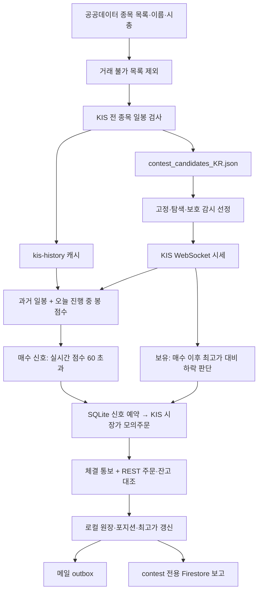

# 대회 분석·감시·자동 모의매매

> 2026-10-16: [캐시를 구독 전에 일괄 준비하고 감시 교체 뒤에도 유지하는 개선](../CONTEST_CACHE_REUSE_2026-10-16.md)을 서버에 반영했다. 최근 관측 점수의 시각과 이력 준비/누락/대기 수를 별도로 기록한다.

확인: 2026-10-15 배포 소스와 22:36 상태, 같은 조사에서 서버 설정 파서 재확인. 실제 실행은 KIS **모의투자 REST**다. 사용자가 말하는 분석 AI는 현재 코드상 LLM 호출이 아니라 기술지표·가중 점수·정해진 주문 규칙으로 동작한다.

## 1. 처리 흐름

공개 사이트의 공공데이터 분석·상위 200개 저장은 별도 파이프라인이다. 대회 KIS 원시 가격과 점수를 공개 feed로 게시하는 연결은 없다.

## 2. 실제 적용값

서버에서 `load_server_env('functions/.env.contest')` 후 `build_parser()`만 실행해 확인했다. 브로커 호출이나 주문 실행은 하지 않았다.

| 항목 | 현재 값 | 근거·의미 |
|---|---|---|
| 초기 자금 기준 | 100,000,000원 | 실제 가용 자금은 매번 KIS 잔고 기준 |
| 매수 점수 | **실시간 점수 > 60** | 60.00은 매수하지 않음 |
| 고정 감시 최소 | **55 이상** | 코드 정책값, 55 미만 교체 |
| 감시 상한 | 39개 | execute에서 39로 제한, 체결 통보 1개 별도 |
| 탐색 기본 | `ceil(39×0.1)=4`개 | 고정이 비면 탐색으로 빈자리 채움 |
| 최대 보유 | **3종목** | 일반 env 상속. 코드 기본 5와 다름 |
| 종목당 목표 비중 | 총자산의 20% | 현금 여유·정수 수량으로 더 작아질 수 있음 |
| 매수·매도 | 시장가 | `ORD_DVSN=01`, 주문 단가 0 |
| 부분 매도 | 최고가 대비 **1.8% 이상 하락** | 보유 수량 50%, 해당 보유 기간 한 번 |
| 전량 매도 | 최고가 대비 **3% 이상 하락** | 남은 수량 전부 |
| 세션 | 09:00:00~15:35:00 | 마지막 5분은 프로그램 종료 여유 포함 |
| 신규 매수 마감 | 15:15:00 | 이후 보유 매도·주문 복구는 유지 |
| 후보 교체 주기 | 60초 | 구독 해지/신청 지연은 별도 |
| 상태 보고 주기 | 60초 | 틱마다 Firestore 기록하지 않음 |
| 정기 잔고 동기화 | 300초 | 주문 접수 후 확인은 별도 즉시 worker |
| WebSocket 재접속 대기 | 기본 10초 | 오류·구독 한도 처리에 추가 시간 가능 |
| KIS REST 요청 간격 | 기본 2초 | 프로세스 간 공유 pacing, 제한 시 증가 |
| 일봉 이력 | 최소 완성 120봉, 최대 180봉 | 당일 진행 봉은 완성 과거 봉으로 세지 않음 |
| 원시 1초봉 기록 | 꺼짐 (`record_dir=''`) | 저장 기능은 있으나 현재 경로 미설정 |

REST는 `https://openapivts.koreainvestment.com:29443`이며 클라이언트가 모의 호스트만 허용한다. 현재 WebSocket 설정은 `ws://ops.koreainvestment.com:21000/tryitout`이다. REST 모의 주문 설정과 WebSocket 연결 주소를 혼동하지 않는다. 구독 종류는 시세 `H0STCNT0`, 모의 체결 통보 `H0STCNI9`다.

## 3. 전 종목 검사는 무엇을 의미하나

진입점은 `jobs/contest_market_scan.py`, wrapper는 `server_runtime/run_contest_premarket.sh`다.

1. `load_market_universe('KR')`로 KOSPI·KOSDAQ 종목 코드·이름·시총을 가져온다.
2. `runtime/checkpoints/untradable_KR.json`의 알려진 거래 불가 종목을 제외한다.
3. 직전 감시 목록을 먼저, 그다음 시총·코드 순으로 처리한다.
4. `contest_market_data.load_kis_candles()`가 KIS 조정 일봉을 조회한다. REST 경로는 `/uapi/domestic-stock/v1/quotations/inquire-daily-itemchartprice`, TR `FHKST03010100`다.
5. 한 응답이 최대 100봉이므로 처음에는 이전 구간도 조회해 완성 120봉 이상을 확보한다. 이후 캐시에 새 구간을 합치고 가격 수정·분할 등 과거 종가 변화가 감지되면 오래된 구간도 갱신한다.
6. 공용 `analyze_stock()`으로 점수를 계산하고 종목별 gzip 캐시와 후보 요약을 원자적으로 저장한다. 후보 파일은 초기 생성과 반복 중 10개 단위, 마지막에 갱신된다.
7. 같은 날 성공한 `kisCheckedSession`은 재개 실행에서 재사용한다. 날짜가 바뀌면 새 날짜 검사로 다시 점수를 산출한다. 완료했어도 실패 목록이 남으면 후속 실행에서 재시도한다.

매일 05:00 시작, 06:30·07:30·08:30 재개 기회, 기본 마감 08:50다. flock으로 검사 중복 실행을 막는다. 주간 공휴일 별도 차단이 없는 점과 초기 전체 캐시 처리 시간이 긴 점은 운영 한계다.

이 종목 목록은 “KIS 대회에서 거래 가능함을 사전에 전부 확정한 목록”과 같지 않다. 공공데이터로 종목을 찾고 알려진 제외 종목을 제거한 것이다. 신규 상장 이력 부족·거래 정지·모의투자 제한·데이터 오류는 추가로 발견될 수 있다. `scoreUnavailable`과 거래 불가 확정 목록은 구분한다.

`confidenceScore=0, scorePending=true`는 아직 평가하지 않은 placeholder다. 0점 종목으로 순위를 매기면 안 된다. 완료 점수는 `scorePending=false`, `scoreUnavailable=false`인 행만 사용한다.

오늘 첫 전체 검사는 [총괄 상태](README.md)의 1,457/2,755에서 중단됐다. 18시 연장 실행은 오늘의 일시 실행이며 매일 저녁 검사 크론이 추가된 것은 아니다.

## 4. 일봉과 실시간 점수

`realtime_scoring.valid_history()`는 **현재 세션 이전 날짜**의 유효 OHLCV만 뽑는다. 그 뒤 `score_live_history()`가 WebSocket의 당일 시가·고가·저가·현재가·누적 거래량으로 오늘 진행 중인 봉 하나를 붙여 공용 지표·점수를 다시 계산한다.

따라서 장중 점수는 어제 점수를 고정해서 쓰는 방식이 아니다. 다만 종목의 과거 이력 준비가 끝나지 않았으면 `liveScoreReady=false`라서 매수 판단에 사용할 점수가 없다. 감시 구독 성공·시세 수신·이력 준비·점수 산출은 서로 다른 상태다.

지표 구성:

| 지표 | 계산·판단 | 점수 가중치 |
|---|---|---:|
| 볼린저밴드 | 20봉 평균·표준편차 2배, 압축·상방 이탈·실패·하방 확장 | 0.25 |
| 이동평균 지지 | 5·20·60·120봉 평균, 하단 밴드와 60일선 관계 | 0.20 |
| 일목균형표 | 9·26·52 기간, 구름·전환/기준선·선행/후행 관계 | 0.20 |
| RSI | 14기간 RSI·9기간 신호선, 회복·약화·다이버전스 | 0.10 |
| 거래량 | 상대 거래량을 동반한 돌파·약한 돌파 | 0.10 |

가중치 합은 0.85이고 **사용 가능한 지표의 가중치 합으로 나눈 정규화 가중 평균**을 쓴다. 구성 점수는 음수도 가능하다. 종가가 볼린저 하단보다 낮으면 15점 감점한 뒤 최종 점수를 0~100으로 제한한다. 따라서 단순히 모든 지표가 보통이라고 50점이 되는 방식은 아니다.

`BUY_CANDIDATE`, `STRONG_BUY` 같은 표시 라벨에는 지표 조합 조건도 있다. **현재 대회 매수는 라벨 자체가 아니라 실시간 수치 `>60`을 기준**으로 한다. 보유 중인 종목은 점수보다 먼저 하락 매도 규칙을 평가하므로 보유 점수 갱신·순위 표시가 비보유 종목과 다를 수 있다.

## 5. 고정·랜덤 감시와 교체

`TraderRuntime.refresh_candidates()`와 `select_watch_codes()`가 담당한다.

- 보유 종목과 미확정·미체결 주문 종목을 먼저 보호한다. 점수가 낮아도 감시에서 빠뜨리지 않는다.
- 동일 날짜에 관측한 최근 실시간 점수를 우선 사용하고, 아직 관측하지 않은 종목은 후보 파일의 KIS 검사 점수를 사용한다.
- 기본 고정/보호 영역은 최대 35자리, 탐색은 최소 약 10%인 4자리다. 보호 종목이 고정 자리를 차지하므로 “상위 35 + 보유 별도 무제한”은 아니다.
- 탐색 종목의 점수가 기존 낮은 고정 종목보다 높으면 다음 교체 주기에 고정으로 승격하고 낮은 종목을 내린다.
- 고정 자리가 비어 있으면 55점 이상인 종목을 채운다. 부족한 자리는 랜덤 탐색으로 채워 전체 감시 기회를 사용한다. 그래서 오늘처럼 고정 0·탐색 39가 가능하다.
- 관측 점수가 55 미만인 비보유 종목은 다음 교체에서 제외하고 즉시 같은 교체 후보로 다시 뽑지 않는다.
- 아직 평가하지 못한 탐색 종목은 이력 오류가 없을 때 준비 대기 유예를 둔다. `min(300, max(120, maxWatch × requestInterval × 4))`초이며 현재 값은 300초다. 무기한 고정은 아니다.
- 탐색 queue는 섞어서 순환한다. 구독 해지·신청마다 0.5초 간격이 있어 전체 39개를 바꾸면 교체 작업 자체가 수십 초 걸릴 수 있다.
- 당일 실시간 점수는 감시에서 빠진 후에도 유지한다. 이미 낮아진 종목을 과거의 더 높은 검사 점수로 즉시 고정 복귀시키지 않는다. 다음 날 또는 출처가 바뀌면 해당 점수 복원 조건을 다시 확인한다.
- 구독 제한 오류가 나면 감시 상한을 줄이고 새 매수를 잠시 막은 뒤 재연결·잔고·주문 대조 후 복구한다. 39개 고정 성공을 보장하는 구조는 아니다.

## 6. 매수와 수량

비보유 종목의 새 틱을 받았을 때 이력이 준비되고 **실시간 점수 60 초과**이면 신호를 만든다. 이전의 단기 상승률·거래대금·스프레드·두 번 확인 필터는 현재 이 진입 경로의 추가 조건이 아니다. 단, 아래 운영 제약은 남아 있다.

- 신규 진입 시간 안인지, 점수가 준비됐는지, 보유·주문 중복이 없는지 확인한다.
- 현재 보유와 매수 진행 중 코드를 합쳐 현재 한도 3종목을 적용한다.
- 거래 불가·당일 매도 후 재진입 금지·재시도 대기·UNKNOWN 복구 중이면 새 매수를 막는다.
- 계좌 상태 변경 중에는 중복 매수·매도를 막고, 시세와 최고가 갱신은 유지한다.

예산은 `min(가용 현금 × 0.995, 총자산 × 0.20)`이고 호가 기준으로 정수 수량을 구한다. 시장가이므로 산정에 쓴 호가와 실제 체결가는 다를 수 있다. 수량 0이면 주문하지 않는다. pending 매수 금액은 현금 예약에 반영한다.

SQLite에 고유 신호를 먼저 예약하고 KIS 시장가 주문을 넣는다. Firestore의 부가 보고보다 주문 요청을 우선한다. 시장가 주문은 원하는 시점의 접수를 우선하지만 거래 정지·API 장애·잔량·슬리피지 때문에 즉시 체결이나 정확한 가격을 보장하지는 않는다.

## 7. 매수 이후 최고가와 매도

기준은 **실제 첫 매수 체결 이후의 최고가**다. 매수 전의 전일 고가·당일 고가를 그대로 넣지 않는다. 첫 체결가에서 시작해 이후 수신한 가격과 실제 추가 체결가로 갱신한다.

예를 들어 매수 전 10,000원이었어도 8,000원에 샀다면 시작 최고가는 8,000원이다. 매수 후 8,500원까지 갔다면 이후 최고가는 8,500원이다. 이때 8,347원 이하에서 절반, 8,245원 이하에서 잔량 전부를 매도한다.

3% 이상 갭 하락이면 절반 주문부터 순차로 기다리지 않고 잔량 전부 매도 조건을 우선한다. 부분 매도 수량은 정수 처리하며 1주처럼 작은 수량은 `max(1, int(보유수량×비율))` 규칙으로 1주가 된다. 실제 매도량은 이미 예약한 미체결 매도 수량을 뺀 현재 보유량 이하로 제한한다.

부분 매도 후 최고가와 부분 매도 여부는 유지한다. 전량 청산하면 해당 보유의 상태를 해제하고, 당일 재진입 차단을 유지한다. 원장·전략 상태를 통해 재시작 및 익일 보유 감시를 이어간다. SQLite 전략 파일과 Firestore 포지션을 함께 보존해야 최고가 복구 근거가 남는다.

## 8. 주문 실패·체결 누락 복구

로컬 원장이 주문 상태의 기준이며 Firestore는 보고·포지션 저장을 맡는다. 주문 진행은 예약 → `SUBMITTED` → `PARTIALLY_FILLED` → `FILLED`가 기본이고 명시 거절은 `FAILED`/거절 계열, 접수 여부 불명은 `UNKNOWN`으로 구분한다.

- 주문을 보낸 직후 별도 recovery worker를 깨워 확인한다. 일반 정기 잔고 조회 300초까지 기다리지 않는다.
- WebSocket 체결 통보가 빠져도 원래 주문일의 REST 주문 조회와 KIS 잔고를 대조한다. 증권사 주문번호만 같다고 다른 날 주문을 혼동하지 않는다.
- REST 누적 체결량을 적용한 주문은 늦게 온 증분 통보를 다시 더하지 않는다. 계좌 동기화 결과에 체결 수량을 중복 가산하지 않게 처리한다.
- **명시적 거절**은 주문이 접수되지 않았다는 근거가 있으므로 신호 잠금을 풀고 계좌 확인 후 최신 조건을 다시 평가한다. 종목별 2·4·8·16·30초 backoff가 있다.
- **네트워크 오류 등 접수 불명**은 무조건 다시 보내지 않는다. 새 매수를 정지하고 주문 조회·알림을 이어간다. 주문번호도 없어서 접수 여부를 증명할 수 없으면 자동으로 안전한 재주문을 보장할 수 없다.
- 거래 불가로 확인된 종목은 공유 제외 목록에 남겨 후속 분석과 감시에서 빼며, 보유·진행 주문 보호는 예외다.
- 오래된 종료 주문의 매도 예약 때문에 실제 잔량이 방치되지 않도록 원장·잔고를 대조하고 종료 신호 잠금을 정리한다.

REST 확인 실패 시 확인 주기는 최대 30초로 늦춘다. 모든 대회 클라이언트는 `kis_request_rate.sqlite3`를 공유해 기본 2초 간격으로 호출한다. 주문 요청에는 차트 조회 양보 구간을 두고, 차트 요청 timeout은 5초·기타 요청은 25초다. 증권사 요청 제한에 걸리면 간격을 최대 8초까지 늘릴 수 있다. 이미 전송된 HTTP 요청을 없애는 기능은 아니므로 지연이 완전히 0인 것은 아니다.

휴장 확인은 원칙적으로 실패 시 진입을 막지만, 모의 API에서 특정 휴장 조회 기능이 지원되지 않는 오류에 대해서는 **평일 여부로 fallback하는 예외**가 있다. “모든 휴장 오류를 완전히 차단”이라고 문서화하면 실제 코드와 다르다.

## 9. 이메일

`jobs/contest_notifications.py`, `OrderStateStore.email_outbox`가 담당한다.

| 이벤트 | 담기는 내용 |
|---|---|
| 매수·매도 실제 체결 | 이름·코드·방향·이번 체결 수량·가격·금액·누적 체결·잔량·현재 보유·사유 |
| 오류로 새 진입 정지 | 상태·종목/주문 등 관련 사유, 인증값을 제거한 상세 |
| 복구·재개 | 대조 완료·연결 복구 등 재개 사유 |
| 비정상 프로세스 종료 | execute wrapper의 종료 코드·오류 정보 |
| 마감 보고 | 현금·총자산·손익·보유·당일 체결·미확인 주문·검사/감시 점수 |

발송을 SQLite outbox에 먼저 넣고 고유 이벤트 key로 중복을 막는다. SMTP 재시도와 120초 처리 lease, 고정 Message-ID가 있다. SMTP가 접수한 직후 프로세스가 죽는 경계에서는 수신 측 중복 가능성을 완전히 배제할 수 없다. 잘못된 주소·수신함 분류까지 서버가 보장하는 것은 아니다.

`contest_daily_report.py`는 주문하지 않고 KIS 잔고·당일 주문을 읽는다. 15:40 최초, 이후 예약 시간에는 정상 보고를 이미 보냈으면 다시 보내지 않는다. 일부 조회 오류는 별도 오류 key로 알리고 정상 조회가 회복되면 정상 보고를 보낸다. `--preview`는 발송 key를 소비하지 않는다. 첫 정상 보고는 비교 기준이 없어 전회 대비 일일 손익을 추정하지 않는다.

## 10. 담당 파일

| 파일 (`functions/` 아래) | 역할 |
|---|---|
| `jobs/kis_realtime_trader.py` | 세션 생명주기, 감시 교체, 시세·신호·주문·복구·상태 |
| `jobs/contest_market_scan.py` | 비공개 KIS 전체 검사·재개 |
| `jobs/contest_daily_report.py` | 마감 계좌·점수 보고 |
| `jobs/contest_notifications.py` | 체결·정지·재개·종료 알림 |
| `strategy_engine/contest_market_data.py` | KIS 일봉 캐시·병합·원자적 파일 저장 |
| `strategy_engine/realtime_scoring.py` | 완성 과거 봉 검증 + 오늘 봉 점수 |
| `strategy_engine/realtime_policy.py` | 고정 감시 선정·진입·하락 매도 등 순수 정책 |
| `strategy_engine/kis_realtime.py` | WebSocket 구독·체결 메시지·갱신 |
| `strategy_engine/kis_paper.py` | 모의 REST·시장가 주문·잔고·일봉·공유 pacing |
| `strategy_engine/order_state.py` | SQLite 원장·전략 상태·메일 outbox |
| `strategy_engine/untradable.py` | 공유 거래 불가 목록 |
| `strategy_engine/indicators.py`, `scoring.py`, `analysis.py` | 웹·대회·재생에서 재사용하는 계산 |
| `strategy_engine/repositories.py` | Firestore 저장·조회와 contest 이름공간 |

`realtime_policy.py`에는 과거 모멘텀·지정가 보조 함수도 남아 있다. 파일에 함수가 존재하는 것과 현재 `RealtimeSignalEngine.on_tick()`에서 호출하는 정책을 구분해야 한다. 전체 파일 목록과 복사본은 [색인](FILE_INDEX.md)을 참고한다.
