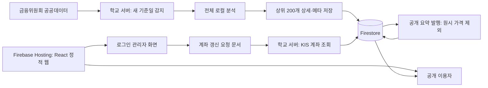

# 웹 서비스·공개 분석·사이트 매매

확인 기준: 2026-10-15 학교 서버 배포 소스, 로컬 웹 소스, 22:37~22:40 Hosting·클라우드 응답. 학교 서버의 오래된 프론트 사본과 현재 웹 배포본을 구분한다.

## 1. 구성과 데이터 흐름

| 계층 | 실제 위치·역할 |
|---|---|
| 화면 | `https://mesu-gak.web.app`, Firebase Hosting |
| 프론트 프로젝트 | 로컬 `Mesugak_V2/frontend`, React·Vite |
| 데이터 계산 | 학교 서버 `functions/jobs`와 `strategy_engine` |
| 공개 데이터 원천 | 금융위원회 공공데이터 API의 확정 일봉 |
| 저장·공개 계약 | Firestore 상세 분석·메타·허용 필드만 담은 공개 요약 |
| 인증 | Firebase Auth Google 로그인, 관리자 문서 확인 |
| 사이트 계좌 조회 | 학교 서버의 별도 조회 worker, 주문하지 않음 |
| 사이트 자동매매 | 학교 서버 크론은 현재 주석 처리 |
| 대회 매매 | 별도 `.env.contest`, KIS 전용 데이터·SQLite·contest 이름공간 |

학교 서버에 웹 프론트 파일이 있어도 브라우저가 그 파일을 직접 서비스받는 구조는 아니다. 현재 계정의 MesuGak 웹 서버 상주 프로세스는 관측되지 않았다.

## 2. 공개 분석 갱신

평일 13~23시 3분마다 `run_v2_kr_watch.sh`가 `jobs/watch_public_data.py`를 호출한다. 공공 API의 새 `basDt`가 발견됐을 때만 전체 분석 wrapper를 실행한다. 이미 처리한 기준일이면 `unchanged`로 끝난다. 실패 재시도에는 기본 30분 대기와 일일 실행량 제한이 있다.

`run_v2_kr_close.sh`의 순서:

1. `.env.server`와 `functions/.env`를 읽고 `runtime/analysis.lock`을 확보한다.
2. `check_cloud_budget.py --kind analysis --reserve`로 클라우드 상태와 로컬 일일 실행 허용량을 확인한다.
3. `analyze_market.py --market KR --analyze-all-local`로 설정된 KOSPI·KOSDAQ 전체를 로컬에서 분석한다. 알려진 거래 불가 종목과 데이터 부족 등 처리 불가 항목은 제외·실패로 기록한다.
4. 점수 내림차순 → 시총 내림차순 → 코드 오름차순으로 **최대 200개**를 골라 Firestore에 저장한다. 200은 전체 검사 대상 수가 아니라 저장 상한이다.
5. `enforce_analysis_retention.py --skip-archive`가 선정 파일을 기준으로 오래된 공개 분석 저장분을 정리한다. 정상 완료 후 선택되지 않은 재생성 가능 로컬 분석 파일도 정리한다.
6. `publish_public_analysis.py`가 원시 가격을 제외한 공개 요약과 manifest를 발행한다.
7. `publish_private_performance.py`가 사이트 계좌의 비공개 성과 비교 자료를 처리한다.
8. 성공 시 `health/last_success_KR.json`, 실패 시 상태·Gmail 알림을 남긴다.

10/15 확인 결과 공개 분석 성공 시각은 **17:05:06 KST**, 분석 기준일은 **10/14**, 유지 종목은 **200개**다. retention 기록에는 이전 257개 중 57개를 정리한 결과가 있다. 이 값은 서버 작업 기록이며 이번 점검에서 Firestore 전체를 다시 스캔한 수치는 아니다.

대회는 당일 KIS 자료를 쓰지만 공개 분석은 공공 API가 제공한 최근 확정 일봉을 쓴다. 공개 API 갱신이 늦으면 웹 기준일도 늦어진다. `runtime/checkpoints/realtime_candidates_KR.json`은 이 공개 분석의 전체 후보 요약이고, 현재 대회가 읽는 `contest_candidates_KR.json`과 다르다.

## 3. 프론트 화면·코드

| 경로·기능 | 주요 파일 |
|---|---|
| `/` 소개·학습 진입 | `App.jsx`, `HomeLandingPage.jsx` |
| `/analysis` 공개 분석·관리자 연구 화면 | `AnalysisLandingPage.jsx`, 지연 로딩되는 `ResearchApp.jsx` |
| `/learn` 및 지표·사례·실험실 | `LearningPages.jsx`, `CaseStudyVisuals.jsx` |
| 상세 지표 글 | `content/articles/*.md`, `indicatorArticles.js` |
| 이용약관·개인정보·데이터·면책 등 | `LegalPages.jsx`, `content/legalCopy.js` |
| Firebase 초기화·인증 | `firebase.js` |
| 공개 데이터·광고 활성 조건 | `monetizationGate.js`, `AdSenseSlot.jsx`, `analytics.js` |
| 미리 생성한 HTML | `scripts/prerender.mjs`, `frontend/dist` |

`App.jsx`가 URL을 분기한다. `/analysis`는 먼저 정적 소개 화면과 맞는 초기 화면을 렌더링하고, 브라우저에서 `ResearchApp`을 지연 로딩한다. 학습·법적 안내 페이지는 정적 HTML 생성 대상이다. 모르는 경로는 찾을 수 없음 화면으로 처리한다.

공개 데이터 조회는 `public_analysis_meta`의 manifest와 필요한 페이지 문서만 `getDoc()`으로 읽는다. 페이지당 30개이고, 브라우저 `sessionStorage`에 15분 캐시하며 동시에 같은 문서를 요청하면 합친다. 공개 분석 컬렉션 전체 목록 조회는 사용하지 않는다. 상세 가격·차트는 관리자 경로에서 선택 종목을 필요할 때 읽는다.

관리자는 `meta_data` 최대 30문서, 거래 로그 최대 120건, 주문·포지션 등에 제한을 둔 조회를 사용한다. 계좌 새로고침을 누르면 `paper_refresh_requests`에 요청을 넣고 그 요청의 완료 상태를 구독한다. 학교 서버가 평일 09~16시 10분마다 처리하므로 버튼을 눌렀다고 즉시 KIS를 호출하는 구조는 아니다.

현재 로컬 빌드 환경에는 공개 데이터 활성화 플래그가 true, AdSense 활성화 플래그가 false다. 플래그와 승인 참고 문자열의 존재는 별도의 데이터 이용권·광고 계정 심사 완료를 증명하지 않는다. 이번 작업에서 설정·심사·광고를 변경하지 않았다.

### 실제 웹과 로컬·서버의 차이

22:37경 `/`, `/analysis/`, `/learn/rsi/`, `/robots.txt`는 HTTP 200이었고 로컬 `frontend/dist` 파일과 바이트 단위로 일치했다. HTML의 주 스크립트는 `/assets/index-Dt7OHLDB.js`였다. 관측 URL·SHA-256은 복사본의 `hosting-observation.json`에 있다.

이 검사는 주요 정적 응답 검증이다. 로그인·관리자 계좌 화면·실제 Firestore 읽기·모든 JS 청크·모든 반응형 화면을 새로 테스트한 것은 아니다. 서버의 `frontend/`와 `firebase.json`은 최신 로컬 소스와 다른 사본이므로 서버 폴더만 내려받아 최신 웹을 재배포하면 안 된다.

## 4. Firestore 역할 구분

| 컬렉션 | 용도 |
|---|---|
| `stock_analysis` | 관리자 상세 분석·가격·이력, 선정 종목 보관 |
| `meta_data` | 관리자용 분석 목록 묶음 |
| `public_analysis_meta` | 공개 가능한 점수·상태·설명, 페이지와 manifest |
| `admins` | 관리자 권한 문서 |
| `users` 및 하위 문서 | 본인 사용자 설정 |
| `bot_portfolio`, `bot_account_snapshot`, `bot_trade_logs` | 사이트용 모의계좌·보유·거래 표시 |
| `paper_trading_runtime`, `paper_trading_runtime_events` | 사이트용 실행 상태·이벤트 |
| `paper_performance_private` | 사이트용 비공개 수익률·지수 비교 |
| `paper_refresh_requests` | 관리자 계좌 조회 요청·완료 상태 |
| `strategy_runs`, `target_allocations`, `rebalance_orders`, `risk_state` | 분석·리밸런스·위험 관리 작업 기록 |
| `paper_order_applications`, `intraday_trade_state` | 모의 주문 적용·일중 상태 |
| `strategy_candidates` | 과거 후보 저장 경로, 정리 대상 |
| `pending_orders` | V1 대기 종목 경로, V2 대회 SQLite 원장과 별개 |

대회 repository는 `paper_namespace='contest'`를 지정한다. 다음 8개 컬렉션 이름 앞에 `contest_`를 붙인다: `bot_portfolio`, `bot_trade_logs`, `bot_account_snapshot`, `intraday_trade_state`, `paper_trading_runtime`, `paper_trading_runtime_events`, `paper_order_applications`, `paper_performance_private`.

따라서 웹에서 일반 `bot_*`를 보는 화면이 대회 계좌를 보여준다고 가정하면 안 된다. 현재 `ResearchApp.jsx`는 일반 사이트 컬렉션을 읽는다. 이름공간 분리는 저장 경로의 분리이며, 계좌 인증값이 실제로 다른 계좌인지까지 이 문서에서 비교·공개하지 않는다.

공개 요약은 `analysis.to_public_summary()`가 허용 필드만 새로 만든다. 코드·이름·기준일·점수·지표 상태·해석 이유·위험 표시를 담고, 가격·원시 OHLCV·지표 수치·차트 이력은 복사하지 않는다. 내부 BUY 라벨은 공개용 지표 정렬 수준 라벨로 바꾼다.

로컬 `firestore.rules`의 의도는 공개 KR manifest/page의 직접 읽기만 허용하고 공개 list·클라이언트 쓰기는 차단하는 것이다. 상세 자료는 관리자만 읽고 사용자 설정은 본인만 접근한다. 관리자 권한은 사용자가 직접 바꿀 수 있는 `users`가 아니라 별도 `admins/{email}` 문서로 결정한다. 대회 이름공간에는 별도 클라이언트 허용 규칙이 없어 기본 차단되는 소스 구조다. **배포된 규칙 버전은 이번에 직접 내려받아 검증하지 않았으며**, 서버의 규칙 사본도 로컬과 차이가 있다.

## 5. 사이트 매매와 대회의 차이

| 항목 | 사이트용 | 대회용 |
|---|---|---|
| 진입점 | `school_paper_trader.py` | `kis_realtime_trader.py` |
| 환경 | `.env` | 공통 env + `.env.contest` |
| 현재 실행 | 09:05 주문 크론 중단 | 장중 execute 크론 유지 |
| 데이터 | 저장된 분석 순위 + REST 현재가 조회 | KIS 전체 검사 + WebSocket 당일 봉 점수 |
| 감시 방식 | REST polling 관련 후보·간격 설정 | 최대 39개 구독, 고정·탐색·보호 교체 |
| 정책 | `intraday_policy.py`의 점수·손절·이익 보호·교체 | 실시간 >60, 매수 이후 고가 대비 1.8% 절반·3% 잔량 |
| 주요 상태 | 사이트용 Firestore | SQLite 주문 기준 + contest Firestore |
| 계좌 조회 worker | 계속 예약됨, 주문 없음 | 주문 직후 recovery와 정기 계좌 동기화 |

일반 `.env`에는 매수 55, 후보 20, scan 후보 60, polling 90초, 종목 비중 10% 등의 값이 있다. 이것을 대회 정책이라고 읽으면 안 된다. 반대로 대회에 별도 항목이 없으면 공통값이 상속될 수 있어 현재 최대 보유 3종목 사례처럼 실효 파서를 확인해야 한다.

사이트 wrapper는 인자 없이 실행하면 `--execute`를 붙이므로 단순 상태 확인용으로 실행하지 않는다. 현재의 중단 근거는 크론의 `PAUSED 2026-10-12 ... contest priority` 주석이다. 종료일에 자동으로 주석을 해제하는 예약은 확인되지 않았다.

## 6. 비용·보관·상태 감시

- 공개 분석은 전체 로컬 계산과 Firestore 최대 200개 저장을 분리한다. 전체 검사 결과를 모두 클라우드에 쓰지 않는다.
- 로컬 `cost/budget.sqlite3`는 미국 Los Angeles 날짜 기준으로 analysis 하루 1회, refresh 하루 48회 예약을 제한한다. 실패한 시도도 예약량을 소비한다.
- Cloud Monitoring 기반 가드는 저장량 700 MiB와 읽기·쓰기·삭제 안전선을 검사한다. Spark 결제 미활성화로 Monitoring을 사용할 수 없는 경우는 별도 상태로 기록하며 사용량이 0이라는 뜻이 아니다.
- 17:05 저장소 관리 작업은 과거 `strategy_candidates`를 검증된 서버 보존본으로 옮기고 정리하거나 `stock_analysis` 이력을 축소한다. `candidates-drained`, `analysis-compacted` 완료 파일이 있으면 반복 전체 처리를 생략한다.
- 30분 상태 감시는 공개 분석의 마지막 성공·진행 정체를 확인한다. 현재 일반 env의 기대 완료는 23:30, 진행 정체 기준은 90분, 알림 쿨다운은 12시간이다. 대회 정지·재개 메일과 다른 상태 파일을 쓴다.
- 이 제한은 다른 클라이언트의 읽기나 Hosting 전송량을 모두 통제하는 과금 상한이 아니다. 이번 작업에서는 유료 기능을 활성화하지 않았고 Firestore 전체 조회를 실행하지 않았다.

## 7. 남아 있는 클라우드 리소스

프로젝트는 `studio-5459225470-8cee2`, Hosting target은 `mesugak-target`, 사이트 ID는 `mesu-gak`이다. 22:40 Cloud Billing 조회는 `billingEnabled=false`였다.

Firebase CLI의 함수 목록 응답에는 아래 리소스가 있었다.

| 함수 | 리전·런타임 | 리소스 상태 | 해석 |
|---|---|---|---|
| `refreshPendingOrdersFromBuySignals` | us-central1 / nodejs24 | ACTIVE | 과거 V1 함수. 현재 예약 실행을 증명하지 않음 |
| `scheduled_paper_flow` | us-central1 / python311 | FAILED | 실패 상태로 남은 리소스 |

로컬 V1 `functions/end_of_day_buy_signals.js`의 전자 로직은 평일 15:40 KST에 `stock_analysis`의 `type=buy_signal`, `market=KR`를 읽어 `pending_orders`를 갱신한다. 코드상 직접 KIS 주문을 내지 않는다. 이 소스와 실제 클라우드 배포 소스의 동일성은 확인하지 않았다.

Cloud Scheduler 및 직접 Functions API 조회는 결제 미활성화 사유의 HTTP 403이었다. 그러므로 현재 스케줄 ENABLED/PAUSED, 최근 호출·성공 시각은 미확인이다. CLI는 목록의 `status=success` 뒤 로컬 설정 저장 문제로 비정상 종료하므로 프로세스 종료 코드와 목록 응답을 구분했다. 필요한 필드만 `cloud-observation.redacted.json`에 보존했다.

V2 `functions/main.py`에는 “Firebase Functions를 배포하지 않는다”는 설명만 있지만, 이것은 현재 V2 소스의 실행 경계이며 **프로젝트 전체의 과거 클라우드 함수가 없다는 증거는 아니다**. 또한 기존 함수 리소스에는 인증 환경변수가 남아 있는 것으로 확인돼, 과거 문서의 “Functions에 KIS 인증정보가 없다”는 문구를 현재 사실로 사용하면 안 된다. 인증값은 이번 문서·복사본에 포함하지 않았다. 리소스 삭제나 환경 변경은 하지 않았다.

## 8. 변경·배포 경계

학교 서버의 분석 코드 수정과 Hosting 화면 배포는 별개다. 최신 프론트는 로컬 작업물·빌드 결과를 기준으로 검증해야 하며 학교 서버의 옛 `frontend`로 덮어쓰지 않는다. Hosting 작업이 Firestore 규칙·Functions·결제 설정 변경까지 포함하는 것은 아니다.

이번 작업은 운영 문서와 복사본 작성이다. 빌드·배포·사이트 매매 재개·클라우드 함수 삭제를 수행하지 않았다.
